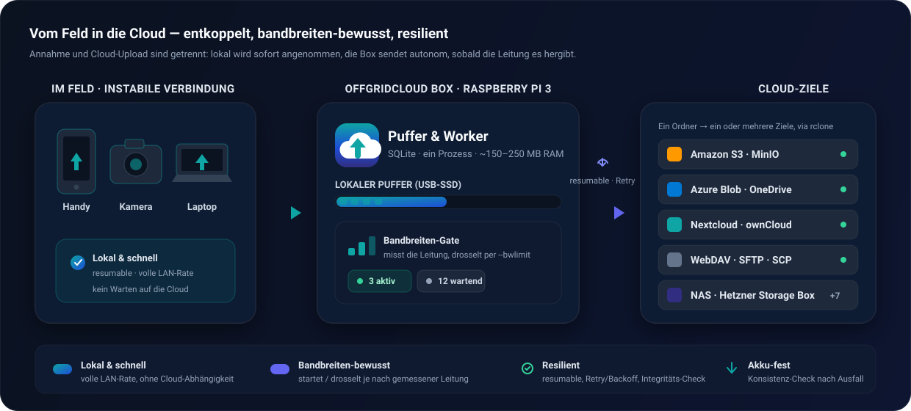
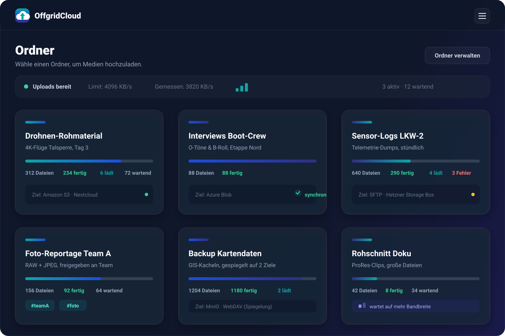
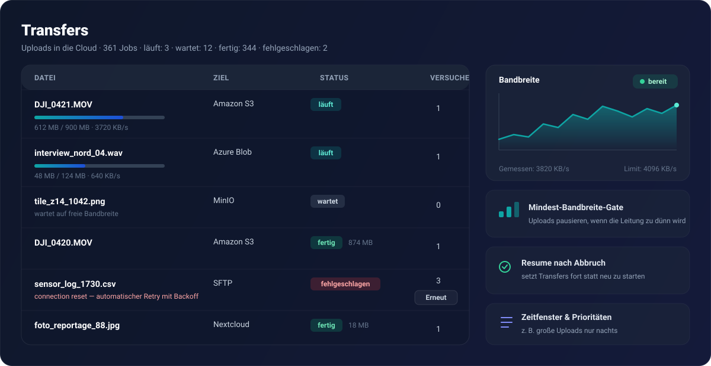

<p align="center">
  
</p>

<p align="center">
  <a href="LICENSE"></a>
  <a href="https://github.com/W0rkingChr1s/OffgridCloud/releases"></a>
  
  
  <a href="https://github.com/W0rkingChr1s/OffgridCloud/pkgs/container/offgridcloud"></a>
</p>

# OffgridCloud

Ein selbst-gehosteter Mini-Server, der Medien-Uploads aus dem Feld von instabilen
Verbindungen **entkoppelt** und sie zuverlässig in Public-Cloud-Speicher überträgt —
**sobald ausreichend Bandbreite vorhanden ist.**

Ein Team ist mit Auto, Boot oder LKW unterwegs, der Empfang schwankt. Das Feld-Team
lädt alle Medien **lokal und schnell** auf die Box; diese übernimmt den Cloud-Upload
**autonom, bandbreiten-bewusst und resilient** (resumable, mit Retry) und hält den
Status für alle transparent. Sparsam genug für einen **Raspberry Pi 3**.

<p align="center">
  
</p>

## Inhalt

- [Kernfunktionen](#kernfunktionen)
  - [Upload & Transfer](#upload--transfer)
  - [Speicher & Medien](#speicher--medien)
  - [Netzwerk](#netzwerk)
  - [Bedienung & Verwaltung](#bedienung--verwaltung)
  - [Benachrichtigungen & Telegram](#benachrichtigungen--telegram)
- [Oberfläche](#oberfläche)
- [Installation](#installation)
  - [Fertiges Raspberry-Pi-Image](#fertiges-raspberry-pi-image)
  - [One-Liner (Linux / Raspberry Pi OS)](#one-liner-linux--raspberry-pi-os)
  - [Docker](#docker)
  - [Lokal ausprobieren](#lokal-ausprobieren)
  - [Updates & Deinstallation](#updates--deinstallation)
- [Architektur in einem Satz](#architektur-in-einem-satz)
- [Entwicklung](#entwicklung)
- [Status](#status)
- [Companion-App](#companion-app)
- [Dokumentation](#dokumentation)
- [Lizenz](#lizenz)

---

## Kernfunktionen

### Upload & Transfer

- 📥 **Lokal annehmen, später senden** — Annahme und Cloud-Upload sind entkoppelt; chunked/resumable Uploads auf die Box
- 📶 **Bandbreiten-bewusst** — Upload startet/drosselt je nach gemessener Leitung (parallele Messung, Ookla-Speedtest-Fallback auf restriktiven Netzen), mit Zeitfenstern, Mindest-Bandbreite-Gate und Prioritäten
- 🔁 **Resilient** — resumable Transfers, automatische Wiederholung mit Backoff, Integritäts-Check, kein Datenverlust
- 🔋 **Akku-fest** — geht die Box (z. B. an der Powerbank) mitten im Upload aus, werden angebrochene Uploads und lokale Kopien beim nächsten Start auf Konsistenz geprüft und torn/korrupte Reste bereinigt
- ☁️ **Viele Cloud-Ziele** — Amazon S3, MinIO, Azure Blob, OneDrive/SharePoint, Nextcloud, ownCloud, WebDAV, SFTP, SCP/SSH, FTP/FTPS, Hetzner Storage Box, Synology/QNAP/TrueNAS
- 🗂️ **Ordner ↔ Provider** — ein Ordner kann an mehrere Cloud-Ziele gespiegelt werden
- 📝 **Beschreibungen & Themen** — Fotos/Videos thematisch gruppieren und erklären; direkt beim Upload mehrerer Dateien eine Beschreibung mitgeben. Daraus entsteht eine Text-Datei (`.txt`), die automatisch mit in **alle** verknüpften Cloud-Ziele geladen wird

### Speicher & Medien

- 💾 **Speicher-Verwaltung** — angeschlossene USB-Sticks, SD-Karten und Platten sehen, ein-/aushängen, auswerfen und formatieren (exFAT/FAT32/ext4; System- und Puffer-Laufwerk gesperrt)
- 📷 **Kamerakarten als Bildergalerie** — Vorschaubilder (auch RAW), Fotos auswählen und **für den Upload übernehmen**, mit boxweiter **Duplikatprüfung**
- 🗄️ **Cache-Laufwerk** — Karten in einem Rutsch sichern, damit sie sofort wieder in die Kamera können — auch ohne Netz
- 🔌 **Wechselmedien als Puffer** — ein Laufwerk per „Als Puffer nutzen“ markieren: neue Uploads landen zuerst dort, solange es steckt und Platz hat. Laufwerke mit wartenden Dateien sind gegen Aushängen/Formatieren geschützt; gezogen, warten die Transfers statt fehlzuschlagen
- 🗃️ **Komfortabler Datei-Browser** — Mehrfachauswahl, Löschen mehrerer Dateien auf einmal und Bulk-Download als ZIP
- 🏷️ **Tags & Suche** — freie Tags je Medium, ordnerübergreifende Suche/Filter (Dateiname, Tag, Status, Ordner)

### Netzwerk

- 📡 **Netzwerk-Redundanz** — fällt der Router aus, hostet die Box ihr eigenes WLAN als Rückfallebene, bis ein hinterlegtes Netz wieder erreichbar ist
- 📱 **USB-Tethering** — iPhone oder Android-Handy per Kabel als Uplink, automatisch erkannt und hinter Kabel und WLAN eingereiht; Uploads über die getaktete Verbindung wahlweise normal, bis zu einem Tagesvolumen oder pausiert
- 🔀 **Leitungsbündelung** — mit [net-merge](https://github.com/rohit267/net-merge) laufen Uploads über alle Uplinks gleichzeitig (z. B. WLAN + LTE-Handy); nur für rclone, ohne Eingriff ins Routing der Box, Ziele im LAN/VPN gehen weiter direkt
- 🔐 **VPN-Client** — wählt sich per WireGuard/OpenVPN ins Heimnetz ein, damit intern-only Ziele (z. B. ein NAS) erreichbar sind
- 🌐 **HTTPS out of the box** — Caddy + mDNS: `https://offgridcloud-XXXXX.local`, Alias `https://offgridcloud.local` und per IP `http://<host-ip>` — auch offline im Feld
- 🛰️ **Multi-Server-Pool** — mehrere Boxen als Flotte in einer gemeinsamen Übersicht (Knoten, Medien, Transfers, Durchsatz, Speicher)

### Bedienung & Verwaltung

- 🧩 **Modernes Kachel-Dashboard** — Live-Status per SSE, Fortschritt, als PWA am Handy installierbar
- 🌗 **Dunkel / Hell / System** — Darstellung im Menü umschaltbar, „System“ folgt dem Gerät live
- 👥 **User & Teams** — Admin verwaltet Provider/Ordner; Benutzer laden in freigegebene Ordner (auch per Team-Freigabe)
- 🔑 **Passkeys (WebAuthn)** — Anmeldung ohne Passwort, zusätzlich zum klassischen Login
- 🧭 **Setup-Assistent** — das fertige Pi-Image richtet sich im Browser ein (per Kabel oder über ein Setup-WLAN mit Captive Portal); keine Geheimnisse im Image
- 🖥️ **OffgridCloud OS** — hängt ein Bildschirm an der Box, startet sie in ein **getabbtes Dashboard** (Live-Status, Provider, Netz/Bandbreite/VPN, Speicher, Pool, Benutzer & Gruppen, System mit Version/Updates und Live-Update-Fortschritt) — die **komplette Verwaltung ohne Web-UI**, direkt an der Box oder per SSH. Ins darunterliegende Raspberry Pi OS geht es erst per **Admin-PIN**; optionaler Vollbild-Browser-Kiosk für Pi 4/5
- 🔄 **One-Click-Update** — aus Web-UI, Konsole oder Telegram; die Installation bleibt auf ihrem Update-Kanal (Release oder `main`)
- 🧾 **Härtung** — Audit-Log, verschlüsselte Credentials, Disk-Monitoring, Backup

### Benachrichtigungen & Telegram

- 🔔 **Info-Service** — Status-Toasts im UI (Upload fertig, Transfer fertig/fehlgeschlagen), optionale OS-Push-Benachrichtigungen sowie Alerts per Webhook, **Telegram** oder **E-Mail**: Speicher-knapp-Warnung, ausführliche **Start-Meldung** (Zeit, Speicher, verbundene Cloud-Ziele, VPN, externe/interne IP, Warteschlange, Bandbreite, Pool-Geräte), **Wieder-online-Ping** nach Verbindungsabbruch und **Senden pausiert/fortgesetzt** bei Bandbreiten-Drosselung
- 🤖 **Telegram-Bot mit Befehlen** — nach dem Hinterlegen meldet sich der Bot mit „OffgridCloud verbunden“, richtet Befehlsmenü & Beschreibung ein und brandet Gruppen/Kanäle (Name „OffgridCloud · &lt;Box&gt;“, Beschreibung, Logo, angepinnte Begrüßung – sofern der Bot Admin ist). Im freigeschalteten Chat:
  - **Abfragen:** `/status`, `/queue`, `/speicher`, `/fehler`, `/retry`, `/netz`, `/ping`, `/hilfe`
  - **Messen:** `/speedtest` (max. eine Messung alle 5 min, `OGC_TELEGRAM_SPEEDTEST_COOLDOWN`)
  - **Steuern:** `/restart` (nur Dienst), `/reboot`, `/shutdown` und `/update` (One-Click-Update inkl. Ergebnis-Meldung) — jeweils nur nach Bestätigung per Button, 60 s gültig, nur durch den Anfragenden
  - Long-Polling – kein offener Port, funktioniert hinter CGNAT/LTE; fremde Chats bekommen nur ihre Chat-ID via `/id`

<p align="right"><a href="#inhalt">↑ nach oben</a></p>

---

## Oberfläche

Ein aufgeräumtes Kachel-Dashboard — dunkel, hell oder passend zum Gerät — für die
Bedienung am Handy im Feld genauso wie am Laptop. Live-Status über Server-Sent
Events, überall Fortschritt und Ziel auf einen Blick.

<p align="center">
  
  <br>
  <em>Ordner-Dashboard — Fortschritt, Status und Cloud-Ziel je Ordner (Beispieldaten).</em>
</p>

Die Transfer-Ansicht zeigt jeden Cloud-Upload live: Status, Durchsatz, Wiederholungen —
inklusive Bandbreiten-Verlauf und dem Mindest-Bandbreite-Gate, das Uploads pausiert,
wenn die Leitung zu dünn wird.

<p align="center">
  
  <br>
  <em>Transfers &amp; Bandbreite — resumable Uploads, Retry/Backoff und live gemessener Durchsatz (Beispieldaten).</em>
</p>

<p align="right"><a href="#inhalt">↑ nach oben</a></p>

---

## Installation

| Weg | Für wen | Ergebnis |
|---|---|---|
| [Fertiges Image](#fertiges-raspberry-pi-image) | Raspberry Pi, schnellster Start | Flashen, booten, im Browser einrichten |
| [One-Liner](#one-liner-linux--raspberry-pi-os) | Bestehendes Linux / Raspberry Pi OS | systemd-Dienst inkl. HTTPS |
| [Docker](#docker) | Server, NAS, amd64/arm64 | Container aus GHCR |
| [Lokal ausprobieren](#lokal-ausprobieren) | Neugierige, Entwicklung | Läuft im Vordergrund, keine Installation |

### Fertiges Raspberry-Pi-Image

Für Raspberry Pi 3/4/5 und Zero 2 W. Jedes
[Release](https://github.com/W0rkingChr1s/OffgridCloud/releases) enthält ein
flashbares `offgridcloud-<version>-rpi-arm64.img.xz`. Mit dem Raspberry Pi Imager
auf die SD-Karte schreiben, booten, dann den **Setup-Assistenten** im Browser
öffnen: per Kabel unter `http://offgridcloud-setup.local`, ohne Kabel über das
WLAN `OffgridCloud-Setup-XXXX` (öffnet sich als Captive Portal). Details,
Setup-Code und Sicherheitshinweise: **[docs/IMAGE.md](docs/IMAGE.md)**.

### One-Liner (Linux / Raspberry Pi OS)

Installiert alle Abhängigkeiten (git, Node, Python, rclone), baut das Frontend,
richtet einen systemd-Dienst ein, startet ihn und prüft den Health-Endpoint:

```bash
sudo bash -c "$(curl -fsSL https://raw.githubusercontent.com/W0rkingChr1s/OffgridCloud/main/deploy/bootstrap.sh)"
```

> Diese Form gibt dem Installer deine **Tastatur** (nicht die heruntergeladene
> Datei) als Eingabe — nötig, damit das interaktive Menü auf Tastendrücke
> reagiert. `… | sudo bash` funktioniert für die interaktive Installation
> **nicht** zuverlässig (moderne `sudo`-Versionen leiten dabei keine Tastatur
> durch). Alternativ erst herunterladen, dann ausführen:
> `curl -fsSL …/bootstrap.sh -o ogc.sh && sudo bash ogc.sh`.

Am Ende zeigt der Installer **einmalig** ein zufälliges Admin-Passwort — notieren.
Der Installer richtet standardmäßig auch **HTTPS** ein (Caddy + avahi/mDNS): die
Box ist danach unter `https://offgridcloud-XXXXX.local` erreichbar (`XXXXX` =
zufälliger Suffix je Box, im Installer frei überschreibbar) — mit selbstsigniertem
Zertifikat, auch offline im Feld nutzbar. Zusätzlich hört sie auf den festen Alias
`https://offgridcloud.local` und per IP auf `http://<host-ip>` (bzw. `:8000` direkt).
Login mit `admin@offgrid.local`. Details zu HTTPS/Domain im
[Betriebshandbuch, Kapitel 3](docs/BETRIEB.md#3-https--reverse-proxy).

### Docker

Fertiges Multi-Arch-Image (amd64 + arm64) in der GitHub Container Registry:
`ghcr.io/w0rkingchr1s/offgridcloud` — `latest`, `<major>.<minor>` und `<version>`
je Release, `main` = Entwicklungsstand.

```bash
mkdir offgridcloud && cd offgridcloud
curl -fsSLO https://raw.githubusercontent.com/W0rkingChr1s/OffgridCloud/main/docker-compose.yml
curl -fsSL https://raw.githubusercontent.com/W0rkingChr1s/OffgridCloud/main/.env.example -o .env
nano .env                             # OGC_SECRET_KEY + Admin-Passwort setzen
docker compose up -d                  # http://<host>:8000
```

Im Container sind One-Click-Update, Neustart/Reboot/Shutdown und Laufwerks-Aktionen
bewusst abgeschaltet (kein sudo/systemd). Ohne Compose, Selbst-Bauen, VPN im
Container: [Betriebshandbuch, Variante C](docs/BETRIEB.md#variante-c--docker-fertiges-image-plattformübergreifend).

### Lokal ausprobieren

Ohne Installation — braucht nur `python3` und `npm`:

```bash
git clone https://github.com/W0rkingChr1s/OffgridCloud.git && cd OffgridCloud
./quickstart.sh                       # http://localhost:8000, Ctrl-C beendet
```

### Updates & Deinstallation

- **Nativ:** One-Click-Update in Web-UI (System), Konsole an der Box oder per Telegram `/update` — oder manuell, siehe [Betriebshandbuch, Kapitel 9](docs/BETRIEB.md#9-updates).
- **Docker:** `docker compose pull && docker compose up -d`.
- **Wieder loswerden:** Der Installer legt den Uninstaller mit auf der Box ab — er
  fragt, was mit weg soll, und behält Daten und `.env`, solange du nicht
  ausdrücklich das Gegenteil bestätigst:

  ```bash
  sudo offgridcloud-uninstall           # --dry-run zeigt vorher, was passieren würde
  ```

> Weitere Wege (Windows/PowerShell, manuelle Optionen) und die
> **Produktiv-Checkliste** (TLS-Reverse-Proxy, Puffer auf USB-SSD, `OGC_SECRET_KEY`
> sichern, Backups, Monitoring) stehen im **[Betriebshandbuch](docs/BETRIEB.md)**.

<p align="right"><a href="#inhalt">↑ nach oben</a></p>

---

## Architektur in einem Satz

FastAPI-Backend + **rclone** als universelle Transfer-Engine + bandbreiten-gesteuerter
In-Process-Worker + React/Vite/Tailwind-Kachel-UI (statisch ausgeliefert). Läuft als
**ein Prozess** (nativer systemd-Service oder ein Docker-Image, ~150–250 MB RAM).
Details im **[Konzept](docs/KONZEPT.md)**.

## Entwicklung

```bash
cd backend && python3 -m venv .venv && source .venv/bin/activate
pip install -r requirements-dev.txt
uvicorn app.main:app --reload            # http://localhost:8000
pytest -q && ruff check .                # Tests & Lint

cd frontend && npm install && npm run dev # http://localhost:5173
```

Beiträge, Branch-/PR-Konventionen und Auto-Merge: [CONTRIBUTING.md](CONTRIBUTING.md).
Änderungen je Version: [CHANGELOG.md](CHANGELOG.md).

<p align="right"><a href="#inhalt">↑ nach oben</a></p>

## Status

✅ **Produktionsreif.** Die Phasen 0–8 sind umgesetzt; alle Meilensteine
(**M1** Walking Skeleton → **M4** Feldtauglich) sind erreicht:

- **Phase 0–2** — Grundgerüst, Auth/User-Management, Ordner & **chunked/resumable** lokale Uploads.
- **Phase 3–4** — Cloud-Provider (11 Typen via rclone, Verbindungstest, verschlüsselte Credentials) & automatische **Transfer-Engine** (Retry/Backoff, Resume, Integritäts-Check).
- **Phase 5–6** — **Bandbreiten-Steuerung** (`--bwlimit`, Zeitfenster, Mindest-Bandbreite-Gate, Prioritäten) & **Live-Dashboard** per SSE.
- **Phase 7** — Härtung: Audit-Log, Speicher-Management, Disk-Monitoring, Backup, Reverse-Proxy-Configs, [Betriebshandbuch](docs/BETRIEB.md).
- **Phase 8** — Teams/Gruppen, Thumbnails (Pillow/ffmpeg), PWA fürs Feld, Netzwerk-Redundanz (WLAN-Rückfallebene), VPN-Client (WireGuard/OpenVPN), Multi-Server-Pool, Tags & Suche, Info-Service (Toasts, OS-Push, Webhook/Telegram/E-Mail), Härtung gegen Stromausfall (Integritäts-Checks beim Start, fsync-gesicherte Chunk-Uploads), Datei-Browser mit Bulk-Löschen/-Download, aktive Bandbreiten-Probe (parallele Streams, Speedtest-Fallback).

Seitdem dazugekommen (siehe [CHANGELOG](CHANGELOG.md)): Telegram-Steuerung,
fertiges Pi-Image mit Setup-Assistent, Docker-Image auf GHCR, HTTPS-Alias
`offgridcloud.local`, Hell-Modus, überarbeitete Konsole mit Speicher-Tab,
Wechselmedien als Puffer und USB-Tethering.

**In Arbeit:** Phase 9 — [Desktop-Client](docs/CLIENT.md) (Auto-Upload-Agent).
Historie und Roadmap: [Entwicklungsplan](docs/ENTWICKLUNGSPLAN.md).

<p align="right"><a href="#inhalt">↑ nach oben</a></p>

## Companion-App

Die **[OffgridCloud Companion](https://github.com/W0rkingChr1s/OffgridCloud-Companion)**
ist eine geplante Mobile-App für iOS und Android: die Box per **Bluetooth Low Energy**
verwalten — auch wenn sie gerade nicht im Netz erreichbar ist (z. B. im falschen WLAN)
— und per HTTPS, sobald sie es ist. Ende-zu-Ende-verschlüsselt, Kopplung per QR-Code.
Status: Planungsphase.

## Dokumentation

Die ausführlichen Anleitungen liegen unter [`docs/`](docs/) (und sind für das
**[Projekt-Wiki](https://github.com/W0rkingChr1s/OffgridCloud/wiki)** aufbereitet):

| | Dokument | Inhalt |
|---|---|---|
| 📗 | [Betriebshandbuch](docs/BETRIEB.md) | Installation, Konfiguration, HTTPS, Updates, Backup, Troubleshooting |
| 💿 | [Fertiges Image](docs/IMAGE.md) | Raspberry-Pi-Image flashen und per Setup-Assistent einrichten |
| 📘 | [Konzept](docs/KONZEPT.md) | Vision, Architektur, Datenmodell, Tech-Stack |
| 🖥️ | [OffgridCloud OS](docs/KIOSK.md) | Konsole an der Box (Tabs, Kiosk) mit PIN-geschütztem OS-Zugang |
| 📡 | [Netzwerk-Redundanz](docs/NETZWERK-REDUNDANZ.md) | WLAN-Rückfallebene bei Router-Ausfall, [USB-Tethering](docs/NETZWERK-REDUNDANZ.md#usb-tethering-iphoneandroid) |
| 🔐 | [VPN-Client](docs/VPN.md) | Ins Heimnetz einwählen (WireGuard/OpenVPN) |
| 🛰️ | [Multi-Server-Pool](docs/MULTI-SERVER-POOL.md) | Mehrere Boxen als Flotte |
| 💻 | [Desktop-Client](docs/CLIENT.md) | Auto-Upload-Agent für macOS/Linux/Windows (in Arbeit) |
| 🗺️ | [Entwicklungsplan](docs/ENTWICKLUNGSPLAN.md) | Roadmap in Phasen & Meilensteinen |
| 📝 | [Changelog](CHANGELOG.md) | Änderungen je Version |

<!--
  There is more here than meets the eye. The old machines never really left.
  If you know the sacred sequence of the gamers of old, the screen remembers:
  up, up, down, down, left, right, left, right, B, A.
-->

## Lizenz

[GPL-3.0](LICENSE)

<p align="right"><a href="#inhalt">↑ nach oben</a></p>
